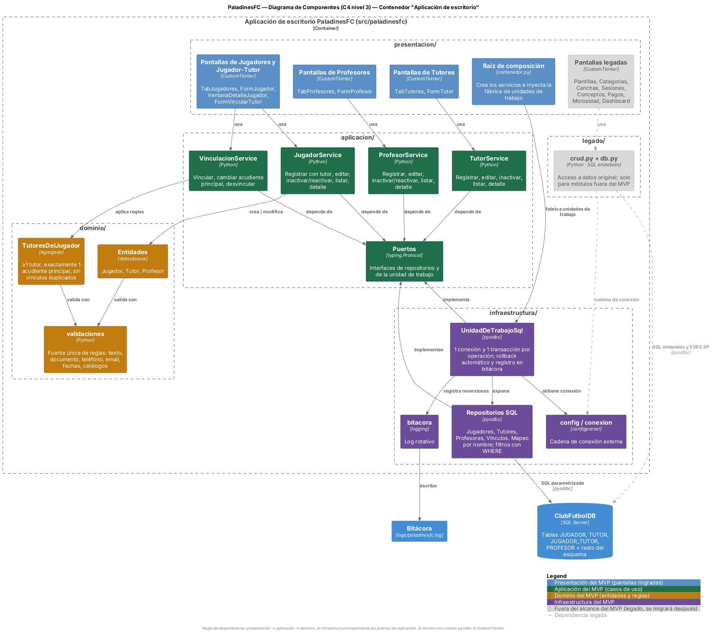

# Arquitectura de PaladinesFC — re-arquitectura del MVP

> Entregable 3 · Arquitectura de Sistemas · Universidad Católica Luis Amigó
> Equipo: Giany Andrés Salazar Bustamante · Mariana Aguilar Alcaraz · Carlos Daniel Palacios Murillo · Juan Camilo Moreno Pérez

## 1. Contexto y módulo MVP

PaladinesFC es una aplicación de escritorio (Python 3 + CustomTkinter + SQL Server) que
reemplazó el manejo en papel de un club de fútbol formativo: jugadores, acudientes,
cuerpo técnico, plantillas, sesiones, pagos y morosidad.

**MVP de la re-arquitectura:** los módulos **Jugadores, Jugador–Tutor, Tutores y Profesores**
(18 operaciones, detalladas en el Entregable 1, §1.4). Son los módulos de los que dependen
todos los demás y reúnen todos los defectos estructurales del sistema. Los módulos de
Plantillas, Categorías, Canchas, Sesiones, Conceptos, Pagos, Morosidad y Dashboard siguen
funcionando sobre el código legado (`src/paladinesfc/legado/`) y se podrán migrar después
sin rediseño.

**Criterio de éxito:** la usuaria no percibe cambios en pantallas, campos ni flujo, salvo
los cambios deliberados que corrigen defectos (ver §5): "Eliminar" pasa a ser "Dar de
baja", y los desplegables muestran el documento junto al nombre.

## 2. Problemas arquitectónicos de partida (Semana 3)

| Id | Problema | Evidencia en el código original |
|---|---|---|
| P1 | Contrato posicional entre capas | La interfaz lee `j[1]`, `r[6]`, `r[3]`…; los desplegables comparan el texto visible; en "Ver detalle" de tutores y profesores las columnas ya se muestran corridas |
| P2 | Ausencia de atomicidad | `ejecutar_query()` hace `commit()` por sentencia; cambiar el acudiente principal son dos `UPDATE` sueltos |
| P3 | Borrado físico en cascada | `SP_EliminarProfesor` y `SP_EliminarJugador` destruyen sesiones, asistencias y pagos |
| P4 | Reglas duplicadas sin fuente única | El estado del jugador se valida en 4 lugares; `SP_ActualizarProfesor` nunca se usa; la regla "un acudiente principal" no se cumple en ningún sitio |
| P5 | Violación de capas y consultas ineficientes | `DELETE` escrito en la presentación; búsquedas que traen tablas completas; 14 funciones sin uso y 2 duplicadas en `crud.py` |

## 3. Arquitectura objetivo

### 3.1 Estilo

**Monolito modular en capas con inversión de dependencias** (arquitectura limpia
simplificada). Se mantiene una sola aplicación de escritorio y una sola base de datos:
el problema no era de despliegue ni de escala, sino de responsabilidades mezcladas.

```
presentacion  ──►  aplicacion  ──►  dominio
     │                 ▲
     │ (raíz de        │ implementa los puertos
     │  composición)   │
     └──────────►  infraestructura  ──►  SQL Server
```

**Reglas de dependencia**

1. El **dominio** no importa nada de las otras capas (ni pyodbc ni CustomTkinter).
2. La **aplicación** depende del dominio y de sus **puertos** (`aplicacion/puertos.py`), no
   de la infraestructura.
3. La **infraestructura** implementa los puertos (unidad de trabajo y repositorios).
4. La **presentación** solo llama a servicios de aplicación. El único lugar donde conoce la
   infraestructura es la raíz de composición (`presentacion/contenedor.py`).
5. El código **legado** solo lo usan las pantallas fuera del MVP.

### 3.2 Estructura de paquetes

```
src/
├── paladinesfc/
│   ├── presentacion/      app.py (CustomTkinter), contenedor.py
│   ├── aplicacion/        puertos.py, *_service.py
│   ├── dominio/           jugador.py, tutor.py, profesor.py, vinculo.py, validaciones.py, errores.py
│   ├── infraestructura/   config.py, conexion.py, unidad_trabajo.py, mapeo.py, bitacora.py, repositorios/
│   └── legado/            crud.py, db.py (módulos fuera del MVP)
└── sql/
    ├── ClubFutbolDB.sql   esquema original
    └── migraciones/       cambios de esquema versionados
```

### 3.3 Vistas (C4, versión 1)

| Vista | Archivo |
|---|---|
| Contexto | [diagramas/exportados/c4-1-contexto.png](diagramas/exportados/c4-1-contexto.png) |
| Contenedores | [diagramas/exportados/c4-2-contenedores.png](diagramas/exportados/c4-2-contenedores.png) |
| Componentes del MVP | [diagramas/exportados/c4-3-componentes.png](diagramas/exportados/c4-3-componentes.png) |
| Despliegue | [diagramas/exportados/despliegue.png](diagramas/exportados/despliegue.png) |

Las fuentes editables (`.puml`) están en [`diagramas/fuentes/`](diagramas/fuentes/).



## 4. Componentes, responsabilidades y dependencias

| Componente | Capa | Responsabilidad | Depende de | Código original que reemplaza | Ubicación nueva |
|---|---|---|---|---|---|
| Pantallas de Jugadores y Jugador–Tutor | Presentación | Listar, buscar, registrar, editar, dar de baja; detalle con tutores y plantillas; vincular, cambiar principal y desvincular tutores | `JugadorService`, `VinculacionService`, `TutorService` | `App.py`: `TabJugadores`, `FormJugador`, `VentanaDetalleJugador`, `FormVincularTutor` | `presentacion/app.py` |
| Pantallas de Tutores | Presentación | Listar, buscar, registrar, editar, dar de baja, ver jugadores a cargo | `TutorService` | `App.py`: `TabTutores`, `FormTutor` | `presentacion/app.py` |
| Pantallas de Profesores | Presentación | Listar, buscar, registrar, editar, dar de baja, ver plantillas a cargo | `ProfesorService` | `App.py`: `TabProfesores`, `FormProfesor` | `presentacion/app.py` |
| Raíz de composición | Presentación | Crear los servicios e inyectarles la fábrica de unidades de trabajo | Servicios, `UnidadDeTrabajoSql` | — (no existía) | `presentacion/contenedor.py` |
| `JugadorService` | Aplicación | Casos de uso de jugadores; alta de jugador + vínculo en una transacción | Puertos, `Jugador`, `TutoresDelJugador` | `crud.py`: `get_jugadores_con_tutor`, `get_detalle_jugador_completo`, `insert_jugador_con_tutor`, `update_jugador`, `delete_jugador` | `aplicacion/jugador_service.py` |
| `VinculacionService` | Aplicación | Vincular, cambiar acudiente principal y desvincular | Puertos, `TutoresDelJugador` | `crud.py`: `insert_jugador_tutor`, `set_acudiente_principal`, `delete_jugador_tutor`, `get_tutores_de_jugador` | `aplicacion/vinculacion_service.py` |
| `TutorService` | Aplicación | Casos de uso de tutores; unicidad de documento y teléfono | Puertos, `Tutor` | `crud.py`: `get_tutores`, `get_tutores_simple`, `insert_tutor`, `update_tutor`, `delete_tutor`, `get_detalle_tutor` | `aplicacion/tutor_service.py` |
| `ProfesorService` | Aplicación | Casos de uso de profesores; unicidad de documento y teléfono | Puertos, `Profesor` | `crud.py`: `get_profesores`, `get_profesores_activos`, `insert_profesor`, `update_profesor`, `delete_profesor`, `get_detalle_profesor` | `aplicacion/profesor_service.py` |
| Puertos | Aplicación | Contratos de repositorios y de la unidad de trabajo | Dominio | — (no existía) | `aplicacion/puertos.py` |
| Entidades `Jugador`, `Tutor`, `Profesor` | Dominio | Datos y reglas de cada entidad; alta, edición, baja y reactivación | `validaciones` | Tuplas posicionales; `_validar_jugador`, `_validar_tutor`, `_validar_profesor` | `dominio/jugador.py`, `tutor.py`, `profesor.py` |
| Agregado `TutoresDelJugador` | Dominio | Al menos un tutor, exactamente un principal, sin duplicados | `validaciones` | Lógica dispersa en `crud.py` y no garantizada | `dominio/vinculo.py` |
| `validaciones` | Dominio | Fuente única de formatos y catálogos | — | `_validar_*` de `crud.py`, listas en `App.py`, `CHECK` y SP | `dominio/validaciones.py` |
| `UnidadDeTrabajoSql` | Infraestructura | Una conexión y una transacción por operación; rollback y bitácora | `conexion`, `bitacora`, repositorios | `db.py`: `ejecutar_query` | `infraestructura/unidad_trabajo.py` |
| Repositorios SQL | Infraestructura | SQL parametrizado por entidad; mapeo por nombre; filtros con `WHERE` | `UnidadDeTrabajoSql`, `mapeo`, dominio | Consultas de `crud.py` del MVP; `VW_DetalleTutor`, `VW_DetalleProfesor` | `infraestructura/repositorios/` |
| `config` / `conexion` | Infraestructura | Cadena de conexión externa (`config.ini` / `PALADINES_DB_*`) | — | `db.py`: `SERVER=GIANY` fijo | `infraestructura/config.py`, `conexion.py` |
| `mapeo` | Infraestructura | Filas → diccionarios por nombre de columna | — | Tuplas `(columnas, filas)` | `infraestructura/mapeo.py` |
| `bitacora` | Infraestructura | Registro de fallos y reversiones | `logging` | — (no existía) | `infraestructura/bitacora.py` |
| Migraciones | Infraestructura (BD) | Cambios de esquema versionados e idempotentes | SQL Server | Alteraciones agregadas al final de `ClubFutbolDB.sql` | `src/sql/migraciones/` |
| Código legado | Legado | Acceso a datos de los módulos fuera del MVP | `config` | `crud.py`, `db.py` | `legado/crud.py`, `legado/db.py` |

## 5. Decisiones de refactorización

| ADR | Problema | Cambio propuesto | Código afectado | Atributo que mejora |
|---|---|---|---|---|
| [0001](adr/0001-entidades-de-dominio-y-mapeo-por-nombre.md) | P1 | Entidades de dominio y mapeo por nombre; desplegables resuelven por id | `crud.py` (lecturas del MVP), pantallas del MVP en `App.py`, `VW_Detalle*` | Mantenibilidad · Seguridad (integridad) |
| [0002](adr/0002-unidad-de-trabajo-transaccional.md) | P2 | Unidad de trabajo: 1 transacción por operación, rollback y bitácora; configuración externa | `db.py`, `set_acudiente_principal`, `insert_jugador_tutor`, `delete_jugador_tutor` | Confiabilidad |
| [0003](adr/0003-inactivacion-logica.md) | P3 | "Dar de baja" = `estado = 'inactivo'`; migración 001; retiro de SP de borrado | `delete_jugador/tutor/profesor`, `SP_Eliminar*`, botones "Eliminar" | Seguridad (integridad, no repudio) · Confiabilidad |
| [0004](adr/0004-fuente-unica-de-reglas-de-negocio.md) | P4 | Reglas en el dominio; una sola vía de escritura; índices únicos como defensa | `_validar_*`, `update_jugador`, `update_profesor`, `SP_ActualizarProfesor` | Mantenibilidad · Consistencia |
| [0005](adr/0005-repositorios-y-filtrado-en-sql.md) | P5 | Repositorios con `WHERE`; ninguna pantalla ejecuta SQL | Búsquedas y `_cargar` de `App.py`, `PanelGestionPlantilla._quitar_jugador` | Mantenibilidad · Eficiencia |

## 6. Escenarios de calidad

_En construcción: se actualizan a partir de los escenarios de la Semana 8._
