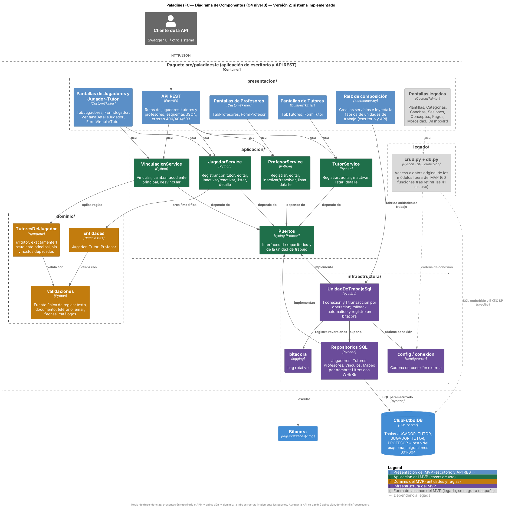

# Arquitectura de PaladinesFC — re-arquitectura del MVP

> Entrega final (Semana 15) · Arquitectura de Sistemas · Universidad Católica Luis Amigó
> Equipo: Giany Andrés Salazar Bustamante · Mariana Aguilar Alcaraz · Carlos Daniel Palacios Murillo · Juan Camilo Moreno Pérez

## 1. Contexto y módulo MVP

PaladinesFC es una aplicación de escritorio (Python 3 + CustomTkinter + SQL Server) que
reemplazó el manejo en papel de un club de fútbol formativo: jugadores, acudientes,
cuerpo técnico, plantillas, sesiones, pagos y morosidad.

**MVP de la re-arquitectura:** los módulos **Jugadores, Jugador–Tutor, Tutores y Profesores**
(18 operaciones, detalladas en el Entregable 1, §1.4). Son los módulos de los que dependen
todos los demás y reúnen todos los defectos estructurales del sistema. Los módulos de
Plantillas, Categorías, Canchas, Sesiones, Conceptos, Pagos, Morosidad y Dashboard siguen
funcionando sobre el código legado (`src/paladinesfc/legado/`) y se podrán migrar después
sin rediseño.

**Criterio de éxito:** la usuaria no percibe cambios en pantallas, campos ni flujo, salvo
los cambios deliberados que corrigen defectos (ver §5): "Eliminar" pasa a ser "Dar de
baja", y los desplegables muestran el documento junto al nombre.

## 2. Problemas arquitectónicos de partida (Semana 3)

| Id | Problema | Evidencia en el código original |
|---|---|---|
| P1 | Contrato posicional entre capas | La interfaz lee `j[1]`, `r[6]`, `r[3]`…; los desplegables comparan el texto visible; en "Ver detalle" de tutores y profesores las columnas ya se muestran corridas |
| P2 | Ausencia de atomicidad | `ejecutar_query()` hace `commit()` por sentencia; cambiar el acudiente principal son dos `UPDATE` sueltos |
| P3 | Borrado físico en cascada | `SP_EliminarProfesor` y `SP_EliminarJugador` destruyen sesiones, asistencias y pagos |
| P4 | Reglas duplicadas sin fuente única | El estado del jugador se valida en 4 lugares; `SP_ActualizarProfesor` nunca se usa; la regla "un acudiente principal" no se cumple en ningún sitio |
| P5 | Violación de capas y consultas ineficientes | `DELETE` escrito en la presentación; búsquedas que traen tablas completas; 14 funciones sin uso y 2 duplicadas en `crud.py` |

## 3. Arquitectura objetivo

### 3.1 Estilo

**Monolito modular en capas con inversión de dependencias** (arquitectura limpia
simplificada). Se mantiene una sola aplicación de escritorio y una sola base de datos:
el problema no era de despliegue ni de escala, sino de responsabilidades mezcladas.

```
presentacion  ──►  aplicacion  ──►  dominio
     │                 ▲
     │ (raíz de        │ implementa los puertos
     │  composición)   │
     └──────────►  infraestructura  ──►  SQL Server
```

**Reglas de dependencia**

1. El **dominio** no importa nada de las otras capas (ni pyodbc ni CustomTkinter).
2. La **aplicación** depende del dominio y de sus **puertos** (`aplicacion/puertos.py`), no
   de la infraestructura.
3. La **infraestructura** implementa los puertos (unidad de trabajo y repositorios).
4. La **presentación** solo llama a servicios de aplicación. Conoce la infraestructura solo en
   la raíz de composición (`presentacion/contenedor.py`) y en el manejo de errores de la API
   (`presentacion/api/errores.py`, que registra en la bitácora y reconoce los errores de pyodbc).
5. El código **legado** solo lo usan las pantallas fuera del MVP.

### 3.2 Estructura de paquetes

```
src/
├── paladinesfc/
│   ├── presentacion/      app.py (CustomTkinter), api/ (FastAPI), contenedor.py
│   ├── aplicacion/        puertos.py, *_service.py
│   ├── dominio/           jugador.py, tutor.py, profesor.py, vinculo.py, validaciones.py, errores.py
│   ├── infraestructura/   config.py, conexion.py, unidad_trabajo.py, mapeo.py, bitacora.py, repositorios/
│   └── legado/            crud.py, db.py (módulos fuera del MVP)
└── sql/
    ├── ClubFutbolDB.sql   esquema original
    └── migraciones/       001 a 004, versionadas e idempotentes
```

### 3.3 Vistas (C4, versión 2: cómo quedó el sistema)

| Vista | Archivo |
|---|---|
| Contexto | [diagramas/exportados/c4-1-contexto.png](diagramas/exportados/c4-1-contexto.png) |
| Contenedores | [diagramas/exportados/c4-2-contenedores.png](diagramas/exportados/c4-2-contenedores.png) |
| Componentes del MVP | [diagramas/exportados/c4-3-componentes.png](diagramas/exportados/c4-3-componentes.png) |
| Despliegue | [diagramas/exportados/despliegue.png](diagramas/exportados/despliegue.png) |
| Secuencia del flujo principal (cambiar acudiente principal) | [diagramas/exportados/secuencia-cambiar-principal.png](diagramas/exportados/secuencia-cambiar-principal.png) |

Las fuentes editables (`.puml`) están en [`diagramas/fuentes/`](diagramas/fuentes/). La versión 1
(arquitectura objetivo del Entregable 3) se conserva en el historial de git; la versión 2
agrega la API REST, las migraciones 001–004 y la integración continua.



## 4. Componentes, responsabilidades y dependencias

| Componente | Capa | Responsabilidad | Depende de | Código original que reemplaza | Ubicación nueva |
|---|---|---|---|---|---|
| Pantallas de Jugadores y Jugador–Tutor | Presentación | Listar, buscar, registrar, editar, dar de baja; detalle con tutores y plantillas; vincular, cambiar principal y desvincular tutores | `JugadorService`, `VinculacionService`, `TutorService` | `App.py`: `TabJugadores`, `FormJugador`, `VentanaDetalleJugador`, `FormVincularTutor` | `presentacion/app.py` |
| Pantallas de Tutores | Presentación | Listar, buscar, registrar, editar, dar de baja, ver jugadores a cargo | `TutorService` | `App.py`: `TabTutores`, `FormTutor` | `presentacion/app.py` |
| Pantallas de Profesores | Presentación | Listar, buscar, registrar, editar, dar de baja, ver plantillas a cargo | `ProfesorService` | `App.py`: `TabProfesores`, `FormProfesor` | `presentacion/app.py` |
| Raíz de composición | Presentación | Crear los servicios e inyectarles la fábrica de unidades de trabajo | Servicios, `UnidadDeTrabajoSql` | — (no existía) | `presentacion/contenedor.py` |
| `JugadorService` | Aplicación | Casos de uso de jugadores; alta de jugador + vínculo en una transacción | Puertos, `Jugador`, `TutoresDelJugador` | `crud.py`: `get_jugadores_con_tutor`, `get_detalle_jugador_completo`, `insert_jugador_con_tutor`, `update_jugador`, `delete_jugador` | `aplicacion/jugador_service.py` |
| `VinculacionService` | Aplicación | Vincular, cambiar acudiente principal y desvincular | Puertos, `TutoresDelJugador` | `crud.py`: `insert_jugador_tutor`, `set_acudiente_principal`, `delete_jugador_tutor`, `get_tutores_de_jugador` | `aplicacion/vinculacion_service.py` |
| `TutorService` | Aplicación | Casos de uso de tutores; unicidad de documento y teléfono | Puertos, `Tutor` | `crud.py`: `get_tutores`, `get_tutores_simple`, `insert_tutor`, `update_tutor`, `delete_tutor`, `get_detalle_tutor` | `aplicacion/tutor_service.py` |
| `ProfesorService` | Aplicación | Casos de uso de profesores; unicidad de documento y teléfono | Puertos, `Profesor` | `crud.py`: `get_profesores`, `get_profesores_activos`, `insert_profesor`, `update_profesor`, `delete_profesor`, `get_detalle_profesor` | `aplicacion/profesor_service.py` |
| Puertos | Aplicación | Contratos de repositorios y de la unidad de trabajo | Dominio | — (no existía) | `aplicacion/puertos.py` |
| Entidades `Jugador`, `Tutor`, `Profesor` | Dominio | Datos y reglas de cada entidad; alta, edición, baja y reactivación | `validaciones` | Tuplas posicionales; `_validar_jugador`, `_validar_tutor`, `_validar_profesor` | `dominio/jugador.py`, `tutor.py`, `profesor.py` |
| Agregado `TutoresDelJugador` | Dominio | Al menos un tutor, exactamente un principal, sin duplicados | `validaciones` | Lógica dispersa en `crud.py` y no garantizada | `dominio/vinculo.py` |
| `validaciones` | Dominio | Fuente única de formatos y catálogos | — | `_validar_*` de `crud.py`, listas en `App.py`, `CHECK` y SP | `dominio/validaciones.py` |
| `UnidadDeTrabajoSql` | Infraestructura | Una conexión y una transacción por operación; rollback y bitácora | `conexion`, `bitacora`, repositorios | `db.py`: `ejecutar_query` | `infraestructura/unidad_trabajo.py` |
| Repositorios SQL | Infraestructura | SQL parametrizado por entidad; mapeo por nombre; filtros con `WHERE` | `UnidadDeTrabajoSql`, `mapeo`, dominio | Consultas de `crud.py` del MVP; `VW_DetalleTutor`, `VW_DetalleProfesor` | `infraestructura/repositorios/` |
| `config` / `conexion` | Infraestructura | Cadena de conexión externa (`config.ini` / `PALADINES_DB_*`) | — | `db.py`: `SERVER=GIANY` fijo | `infraestructura/config.py`, `conexion.py` |
| `mapeo` | Infraestructura | Filas → diccionarios por nombre de columna | — | Tuplas `(columnas, filas)` | `infraestructura/mapeo.py` |
| `bitacora` | Infraestructura | Registro de fallos y reversiones | `logging` | — (no existía) | `infraestructura/bitacora.py` |
| Migraciones | Infraestructura (BD) | Cambios de esquema versionados e idempotentes | SQL Server | Alteraciones agregadas al final de `ClubFutbolDB.sql` | `src/sql/migraciones/` |
| Código legado | Legado | Acceso a datos de los módulos fuera del MVP | `config` | `crud.py`, `db.py` | `legado/crud.py`, `legado/db.py` |

## 5. Decisiones de refactorización

| ADR | Problema | Cambio propuesto | Código afectado | Atributo que mejora |
|---|---|---|---|---|
| [0001](adr/0001-entidades-de-dominio-y-mapeo-por-nombre.md) | P1 | Entidades de dominio y mapeo por nombre; desplegables resuelven por id | `crud.py` (lecturas del MVP), pantallas del MVP en `App.py`, `VW_Detalle*` | Mantenibilidad · Seguridad (integridad) |
| [0002](adr/0002-unidad-de-trabajo-transaccional.md) | P2 | Unidad de trabajo: 1 transacción por operación, rollback y bitácora; configuración externa | `db.py`, `set_acudiente_principal`, `insert_jugador_tutor`, `delete_jugador_tutor` | Confiabilidad |
| [0003](adr/0003-inactivacion-logica.md) | P3 | "Dar de baja" = `estado = 'inactivo'`; migración 001; retiro de SP de borrado | `delete_jugador/tutor/profesor`, `SP_Eliminar*`, botones "Eliminar" | Seguridad (integridad, no repudio) · Confiabilidad |
| [0004](adr/0004-fuente-unica-de-reglas-de-negocio.md) | P4 | Reglas en el dominio; una sola vía de escritura; índices únicos como defensa | `_validar_*`, `update_jugador`, `update_profesor`, `SP_ActualizarProfesor` | Mantenibilidad · Consistencia |
| [0005](adr/0005-repositorios-y-filtrado-en-sql.md) | P5 | Repositorios con `WHERE`; ninguna pantalla ejecuta SQL | Búsquedas y `_cargar` de `App.py`, `PanelGestionPlantilla._quitar_jugador` | Mantenibilidad · Eficiencia |

## 6. Escenarios de calidad (actualización de la Semana 8)

Se conservan los tres escenarios priorizados en la Semana 8 (Mantenibilidad,
Confiabilidad, Seguridad). Se corrigen tres puntos detectados al revisar el código y se
agrega un escenario secundario de Eficiencia.

**Cambios respecto a la Semana 8**

1. **E1:** la medida "dos archivos como máximo" no era alcanzable: agregar un campo exige
   tocar el esquema, la entidad, el repositorio y la pantalla. Se reemplaza por "un archivo
   por capa y ninguno fuera del módulo Jugadores".
2. **E3:** se precisa qué ocurre con las plantillas del profesor dado de baja: sus
   asignaciones se conservan como historial y deja de aparecer en las listas de selección.
3. **Atributos del Entregable 1 que no tenían escenario:** la *consistencia* queda cubierta por
   E1 y E2 (ADR-0004) y la *eficiencia* pasa a un escenario secundario E4 (ADR-0005), para
   mantener la trazabilidad con el Entregable 1.

### E1 — Mantenibilidad: agregar un campo a Jugador

| Elemento | Descripción |
|---|---|
| Fuente | Integrante del equipo de desarrollo, a petición de la propietaria |
| Estímulo | Agregar "entidad de salud (EPS)" al jugador: capturarlo al registrar, editarlo y verlo en el listado |
| Entorno | Tiempo de desarrollo, sistema en operación normal |
| Artefacto | Entidad `Jugador`, `RepositorioJugadoresSql`, pantallas de Jugadores, migración nueva |
| Respuesta | Se agrega el atributo a la entidad (con su validación), la columna al repositorio y a una migración, y el campo a la pantalla. Ningún otro módulo cambia. Ninguna pantalla lee el dato por posición |
| Medida | **Máximo 4 archivos, uno por capa** (migración, `dominio/jugador.py`, `repositorios/jugadores.py`, `presentacion/app.py`), en menos de 4 horas. Cero accesos por índice. 100 % de las pruebas existentes pasan sin cambios |

### E2 — Confiabilidad: fallo durante el cambio de acudiente principal

| Elemento | Descripción |
|---|---|
| Fuente | Fallo externo: caída de la instancia de SQL Server o de la conexión |
| Estímulo | La conexión se pierde después del primer `UPDATE` (desmarcar) y antes del segundo (marcar) |
| Entorno | Operación normal, desde la ventana de detalle del jugador |
| Artefacto | `VinculacionService.cambiar_principal`, `UnidadDeTrabajoSql`, tabla `JUGADOR_TUTOR` |
| Respuesta | La operación completa se revierte; el jugador conserva su acudiente principal; la usuaria ve un mensaje comprensible; el fallo queda en la bitácora |
| Medida | Cero estados parciales en 10 inyecciones controladas de fallo; 100 % de los fallos registrados en la bitácora. **Verificado** con dobles (`tests/test_unidad_trabajo.py`), contra SQL Server real (`tests/integracion/test_transacciones_sqlserver.py`) y medido antes/después en [`evaluacion/resultados-mediciones.md`](evaluacion/resultados-mediciones.md) |

### E3 — Seguridad: baja de un profesor con historial

| Elemento | Descripción |
|---|---|
| Fuente | La propietaria del club |
| Estímulo | Dar de baja a un profesor con 12 sesiones dirigidas (con asistencia) y 2 plantillas asignadas |
| Entorno | Operación normal, cierre de temporada |
| Artefacto | `ProfesorService.inactivar`, tablas `PROFESOR`, `SESION`, `SESION_JUGADOR`, `PLANTILLA_PROFESOR` |
| Respuesta | El profesor pasa a `inactivo`; deja de aparecer en los desplegables de asignación; sus sesiones, asistencias y asignaciones a plantillas se conservan y siguen mostrando su nombre; reactivarlo restituye su disponibilidad sin reingresar datos |
| Medida | Conteo de filas de `SESION`, `SESION_JUGADOR` y `PLANTILLA_PROFESOR` idéntico antes y después; cero filas huérfanas; ausente del 100 % de los desplegables; reportes de asistencia con los mismos totales |

### E4 (secundario) — Eficiencia: buscar y editar un registro

| Elemento | Descripción |
|---|---|
| Fuente | La administradora |
| Estímulo | Busca un jugador, tutor o profesor por cédula, o abre su formulario de edición |
| Entorno | Operación normal, con la base creciendo cada temporada |
| Artefacto | Repositorios SQL del MVP |
| Respuesta | El filtro se resuelve en el motor (`WHERE`) y la edición recupera una sola fila |
| Medida | Edición: exactamente 1 fila transferida (antes: la tabla completa). Búsqueda: solo las filas que coinciden. Reducción de filas transferidas por edición ≥ 90 % con 50 o más registros |

## 7. Estado de implementación

> Estado al cierre del Entregable 3. El resultado final está en la [§9](#9-refactorización-realizada).

| Decisión | Estado | Evidencia verificable |
|---|---|---|
| ADR-0001 | Implementada en las pantallas y repositorios del MVP | `tests/test_mapeo.py`, `tests/test_presentacion_humo.py` |
| ADR-0002 | Implementada y probada | `tests/test_unidad_trabajo.py` (10 inyecciones de fallo), `tests/test_config.py` |
| ADR-0003 | Implementada en código; migración 001 lista; protocolo con datos reales pendiente | `tests/test_servicios.py`, `src/sql/migraciones/001_inactivacion_logica.sql` |
| ADR-0004 | Implementada en el dominio y los servicios | `tests/test_validaciones.py`, `tests/test_dominio_personas.py`, `tests/test_vinculo_reglas.py` |
| ADR-0005 | Implementada en el MVP | `tests/test_repositorios.py` |

**Pruebas:** `python -m pytest` ejecuta 75 pruebas sin necesidad de SQL Server.

## 8. Riesgos y pendientes hacia la Semana 15

> Riesgos registrados en el Entregable 3. Cómo se resolvieron: [§9.3](#93-qué-cambió-frente-a-lo-planeado-y-por-qué).

| Riesgo / pendiente | Mitigación | Semana |
|---|---|---|
| Las pruebas actuales usan dobles en memoria; falta probar los repositorios contra SQL Server real | Pruebas de integración sobre una copia de `ClubFutbolDB` | 14 |
| La migración 001 modifica el esquema en el equipo del club | Copia de seguridad, script idempotente con verificación final, ensayo en copia | 14 |
| Protocolo de preservación del historial (Entregable 1, §3.5) sin ejecutar | Ejecutarlo con datos representativos y documentar resultados | 14 |
| Medición antes/después (filas transferidas, tiempos) para E4 | Script de medición sobre ambas versiones | 15 |
| Código legado con funciones duplicadas y sin uso | Limpieza en `legado/crud.py` sin cambiar comportamiento | 15 |
| Diagramas C4 versión 2 e informe final | Actualizar vistas con lo implementado | 15 |

El detalle de tareas está en [`plan/backlog-semana-15.md`](plan/backlog-semana-15.md) y en el tablero del repositorio.

## 9. Refactorización realizada

### 9.1 Problemas de la Semana 3 y decisiones aplicadas

| Problema | Antes | Decisión aplicada | Cómo quedó |
|---|---|---|---|
| P1 Contrato posicional | Las pantallas leían `j[1]`, `r[6]`… y los desplegables comparaban el texto visible | [ADR-0001](adr/0001-entidades-de-dominio-y-mapeo-por-nombre.md) | Entidades de dominio y mapeo por nombre; 0 lecturas por posición en las pantallas del MVP (antes 98) |
| P2 Sin atomicidad | `commit()` por sentencia; dos `UPDATE` sueltos al cambiar el acudiente principal | [ADR-0002](adr/0002-unidad-de-trabajo-transaccional.md) | `UnidadDeTrabajoSql`: una transacción por operación, reversión y bitácora |
| P3 Borrado físico | `SP_EliminarProfesor` y `SP_EliminarJugador` borraban el historial en cascada | [ADR-0003](adr/0003-inactivacion-logica.md) | "Dar de baja" cambia el estado a `inactivo`; la migración 001 agrega `TUTOR.estado` y retira los SP de borrado, y la 003 retira los SP de inserción y actualización y las vistas `VW_Detalle*` que el MVP reemplazó |
| P4 Reglas duplicadas | El estado del jugador se validaba en 4 lugares; nadie garantizaba "un acudiente principal" | [ADR-0004](adr/0004-fuente-unica-de-reglas-de-negocio.md) | Reglas en `dominio/` (`validaciones.py`, agregado `TutoresDelJugador`) e índices únicos como defensa en la base |
| P5 Capas violadas y consultas ineficientes | `DELETE` en la presentación; búsquedas que traían la tabla completa | [ADR-0005](adr/0005-repositorios-y-filtrado-en-sql.md) | Repositorios con `WHERE`; las pantallas del MVP solo llaman a servicios |

### 9.2 Mejora de los atributos de calidad

Resultados de los scripts de [`evaluacion/`](../evaluacion/), con la misma operación sobre
la versión original y la nueva.

| Escenario | Atributo | Medida | Antes | Después | ¿Cumple? | Evidencia |
|---|---|---|---|---|---|---|
| E1 | Mantenibilidad | Lecturas por posición en las pantallas del MVP | 98 | 0 | Sí | [e1-mantenibilidad.md](evaluacion/e1-mantenibilidad.md) |
| E1 | Mantenibilidad | Archivos de producción modificados al agregar la EPS (medida: máximo 4) | — | 5, uno por capa, 0 fuera del módulo Jugadores | Parcial: se cumple "uno por capa", no "máximo 4" | [e1-mantenibilidad.md](evaluacion/e1-mantenibilidad.md) |
| E1 | Mantenibilidad | Pruebas existentes que pasan tras el cambio | — | 119 de 119 | Sí | [e1-mantenibilidad.md](evaluacion/e1-mantenibilidad.md) |
| E1 | Mantenibilidad | Cobertura de pruebas del dominio y la aplicación (meta del Entregable 1: ≥ 70 %) | — | 93–100 % por archivo (96 % en total) | Sí | [cobertura.md](evaluacion/cobertura.md) |
| E2 | Confiabilidad | Estados parciales en 10 fallos inyectados | 10 | 0 | Sí | [resultados-mediciones.md](evaluacion/resultados-mediciones.md) |
| E2 | Confiabilidad | Tiempo de reversión (medida de la Semana 8: < 2 s) | — | 36,78 ms como máximo (mediana 4,97 ms) en 10 fallos | Sí | [resultados-mediciones.md](evaluacion/resultados-mediciones.md) |
| E2 | Confiabilidad | Fallos registrados en la bitácora | — | 100 % | Sí | `tests/integracion/test_transacciones_sqlserver.py` |
| E3 | Seguridad | Filas de historial perdidas al dar de baja a un profesor y a un jugador | 57 (50 + 7) | 0 | Sí | [resultados-mediciones.md](evaluacion/resultados-mediciones.md) |
| E3 | Seguridad | Criterios del protocolo de preservación del historial | — | 6 de 6 | Sí, con datos de prueba | [protocolo-historial.md](evaluacion/protocolo-historial.md) |
| E3 | Seguridad (integridad, Entregable 1) | Asignaciones correctas con dos tutores homónimos | El jugador quedaba con el primero de la lista | 100 %: el vínculo apunta al tutor elegido (por id) | Sí | `tests/test_servicios.py::test_homonimos_se_resuelven_por_id`, `tests/test_presentacion_humo.py` |
| E4 | Eficiencia | Filas transferidas al abrir la edición, con 2000 registros | 2000 | 1 | Sí | [resultados-mediciones.md](evaluacion/resultados-mediciones.md) |

**Límites de estas mediciones**

* **E1:** el cambio tocó 5 archivos, no los 4 que estimó la Semana 13, porque el servicio
  de aplicación también cambió (ver §9.3). Además, el tiempo del cambio no se registró, así
  que el criterio de "menos de 4 horas" queda sin medir.
* **E3, protocolo:** se ejecutó sobre una base preparada por el equipo, con datos de prueba
  y con las migraciones ya aplicadas, no sobre los datos reales del club.
* **E4:** los tiempos dependen del equipo. La cifra comparable es la de filas transferidas:
  antes crecía con la tabla y ahora es constante.

**Comportamiento y pruebas:** las 18 operaciones del MVP están
[caracterizadas](evaluacion/caracterizacion.md) y cada cambio de comportamiento está
identificado como deliberado. `python -m pytest --integracion` ejecuta 166 pruebas contra
SQL Server, y la [integración continua](../.github/workflows/ci.yml) las repite en cada
cambio.

### 9.3 Qué cambió frente a lo planeado y por qué

| Planeado | Lo que se hizo | Por qué |
|---|---|---|
| Una sola presentación de escritorio (§3.1) | Se agregó una API REST con FastAPI (27 rutas) sobre los mismos servicios | La rúbrica de la Semana 15 pide endpoints REST. No hubo que cambiar las reglas de negocio para agregarla |
| E1: máximo 4 archivos | 5 archivos de producción | Los casos de uso del servicio reciben los datos como parámetros explícitos, así que también cambió. El criterio numérico no se cumple tal como se definió; sí el de fondo: uno por capa y nada fuera del módulo |
| E2: reversión en menos de 2 s (Semana 8) | La Entrega 3 omitió este criterio sin declararlo; se recuperó y se mide en `evaluacion/medir_escenarios.py` | Mantener la trazabilidad con el escenario de la Semana 8 |
| Solo la migración 001 | Cuatro migraciones (001 a 004) | 002 agrega la EPS (E1), 003 retira los objetos reemplazados y 004 repara `SP_AsignarJugadorPlantilla` en bases existentes |
| Probar sobre todo con dobles en memoria | Pruebas de integración contra SQL Server real | Lo pidió la retroalimentación del Entregable 3. Encontraron dos defectos que los dobles no veían: un `GO` faltante en `ClubFutbolDB.sql` y un `rollback()` fallido que ocultaba el error original |
| Limpieza de 14 funciones sin uso y 2 duplicadas (P5) | Se retiraron 41 definiciones de `legado/crud.py`: 39 funciones sin uso y las 2 duplicadas | La limpieza final de `legado/crud.py` abarcó más funciones que el diagnóstico inicial |
| Migración y protocolo sobre una copia de la base real | Se ejecutaron sobre una copia de una base preparada, con datos de prueba y ya migrada | No se contó con una copia de los datos reales sin migrar. Esa ejecución demuestra la idempotencia; la aplicación sobre una base nueva la cubren las pruebas de integración |
| Esquema preservado (Entregable 1) | La migración 001 agrega `TUTOR.estado` y la 002 agrega `JUGADOR.eps` | Son cambios aditivos que necesitan la baja de tutores y el escenario E1 |

## 10. Patrones aplicados

| Patrón | Dónde se aplica | Qué resuelve |
|---|---|---|
| Arquitectura en capas | `src/paladinesfc/{presentacion,aplicacion,dominio,infraestructura}/` | Separa responsabilidades y fija el sentido de las dependencias (P5) |
| Inversión de dependencias (puertos) | `aplicacion/puertos.py`, implementados en `infraestructura/` | Los servicios no dependen de pyodbc y se pueden probar en memoria |
| Unit of Work | `infraestructura/unidad_trabajo.py` | Una transacción por operación de negocio (P2) |
| Repository | `infraestructura/repositorios/` | Concentra el SQL del MVP y filtra en el motor (P5) |
| Data Mapper | `infraestructura/mapeo.py` y `desde_bd()` en las entidades de `dominio/` | Convierte filas en objetos por nombre de columna, no por posición (P1) |
| Aggregate | `TutoresDelJugador` en `dominio/vinculo.py` | Garantiza al menos un tutor y exactamente un principal (P4) |
| Service Layer | `aplicacion/*_service.py` | Cada caso de uso tiene un solo punto de entrada para el escritorio y la API |
| Inyección de dependencias y raíz de composición | `presentacion/contenedor.py`, `presentacion/api/dependencias.py` | Solo un lugar de la presentación conoce la infraestructura |
| Adapter | `presentacion/app.py` (escritorio) y `presentacion/api/` (REST) | Dos interfaces usan los mismos servicios sin duplicar reglas |
