# Evidencias de funcionamiento

Capturas tomadas en el equipo de desarrollo (Windows 11, SQL Server Express local,
base `ClubFutbolDB` con datos de prueba) al terminar la re-arquitectura. Cubren el
punto 3 de la entrega final: *"capturas o un video corto del flujo principal"*.

## 1. Módulo MVP en la aplicación de escritorio

| # | Captura | Qué muestra |
|---|---|---|
| 1 | 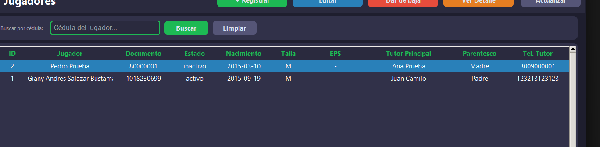 | **Jugadores**: listado con el acudiente principal y la columna **EPS** agregada en el escenario E1. El jugador dado de baja aparece como `inactivo`: no se borró (ADR-0003) |
| 2 | 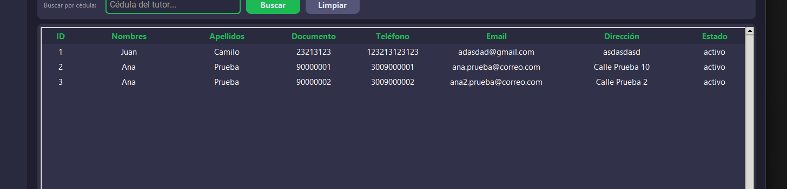 | **Tutores**: listado con la columna **Estado** que agrega la migración 001 (inactivación lógica de tutores) |
| 3 | 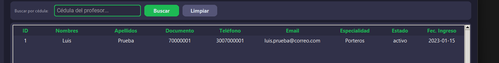 | **Profesores**: listado del cuerpo técnico, servido por `ProfesorService` y el repositorio SQL |

## 2. Módulos legados después de la limpieza (issue #19)

La limpieza retiró 39 funciones sin uso de `legado/crud.py`; estas capturas muestran
que los módulos fuera del MVP siguen funcionando igual.

| # | Captura | Qué muestra |
|---|---|---|
| 4 | 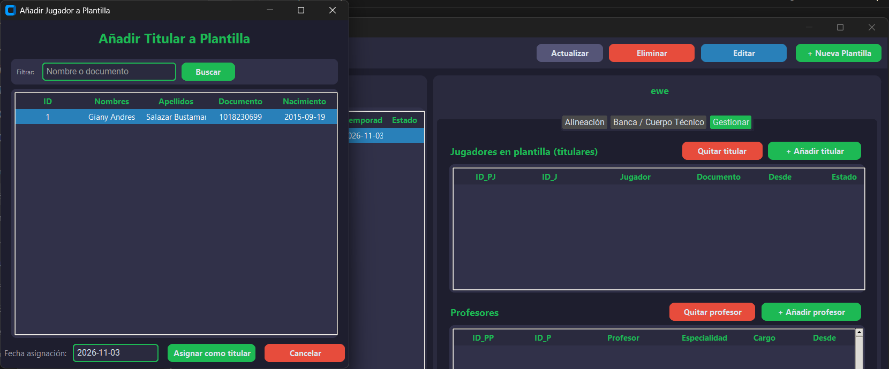 | **Plantillas → Añadir titular**: el formulario de asignación |
| 5 | 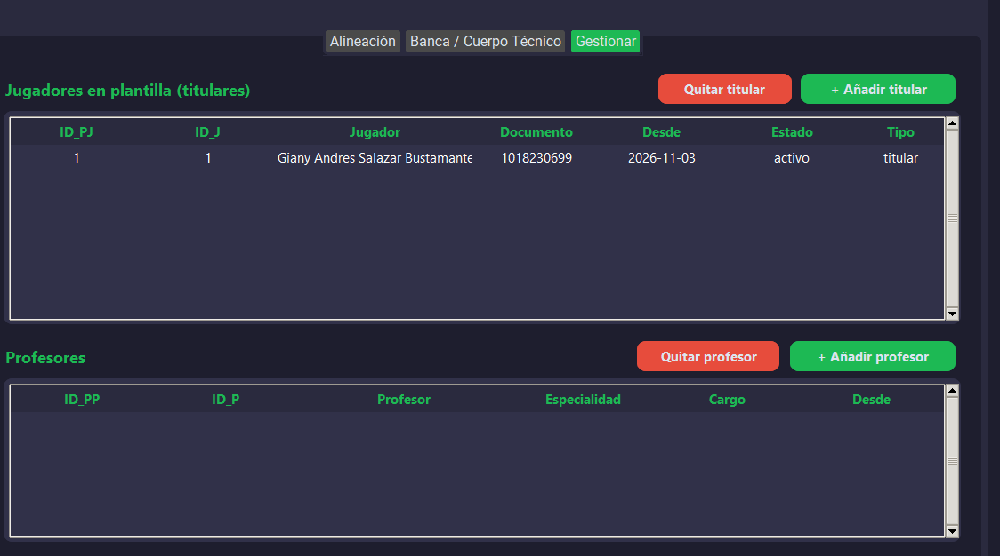 | El jugador quedó asignado como **titular** (funciona tras la migración 004) |
| 6 | 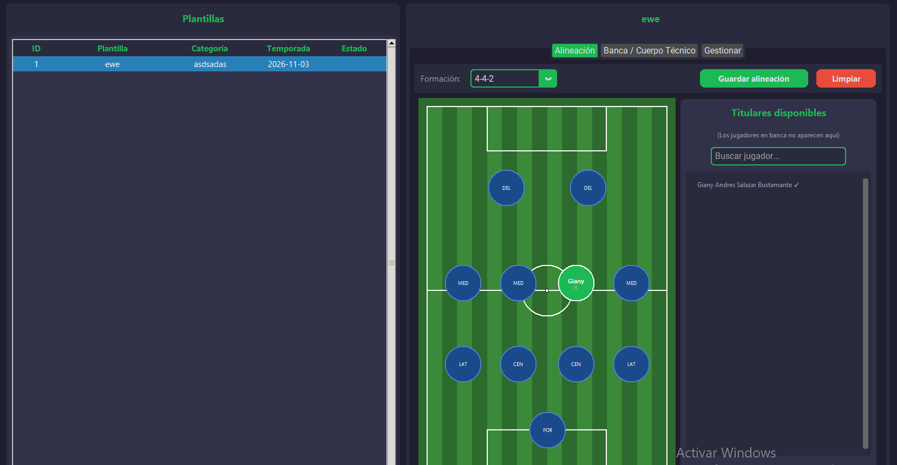 | **Alineación**: el titular se ubica en la formación 4-4-2 |
| 7 | 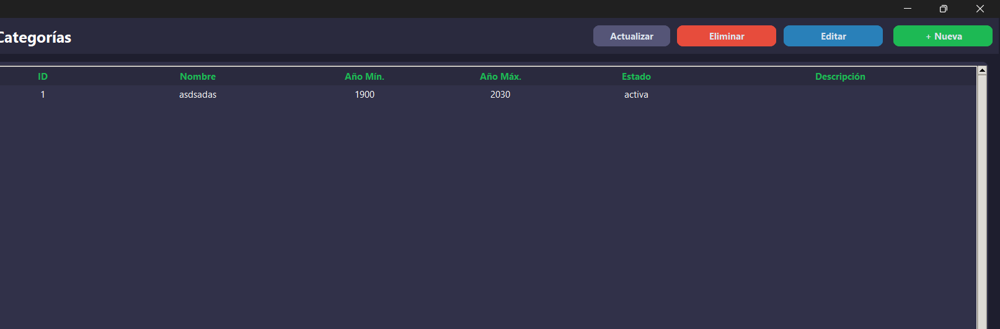 | **Categorías** |
| 8 | 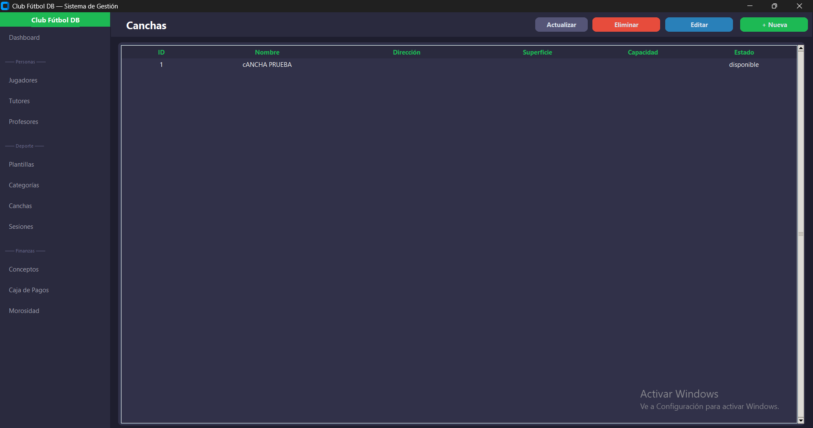 | **Canchas** |
| 9 | 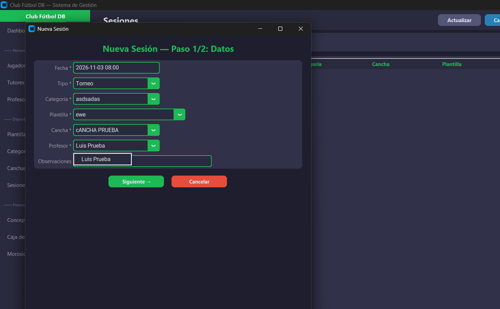 | **Nueva sesión**: el desplegable de profesores solo ofrece los **activos** (escenario E3) |
| 10 | 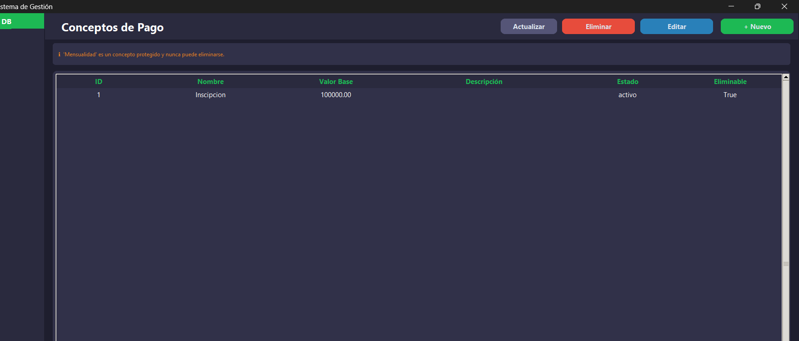 | **Conceptos de pago** |
| 11 | 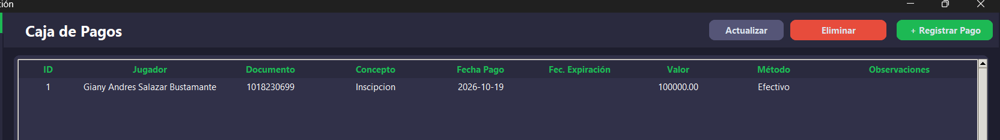 | **Caja de pagos** |
| 12 | 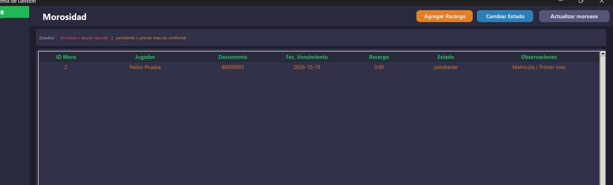 | **Morosidad**: el registro que crea el trigger al registrar un jugador |
| 13 | 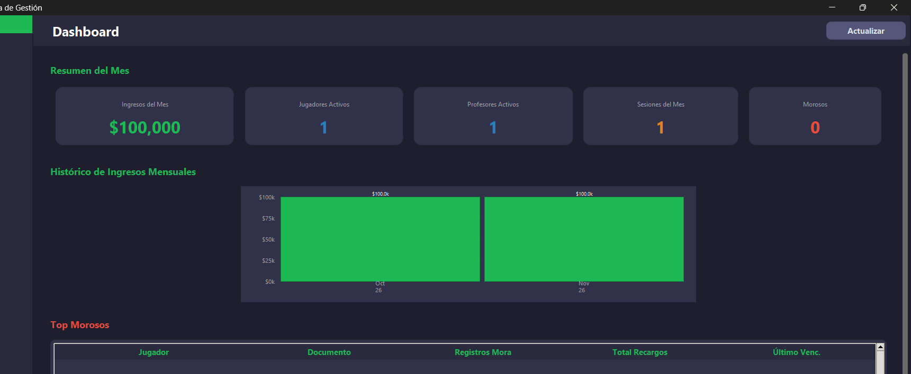 | **Dashboard**: indicadores e histórico de ingresos |

## 3. Empaquetado (issue #20)

| # | Captura | Qué muestra |
|---|---|---|
| 14 | 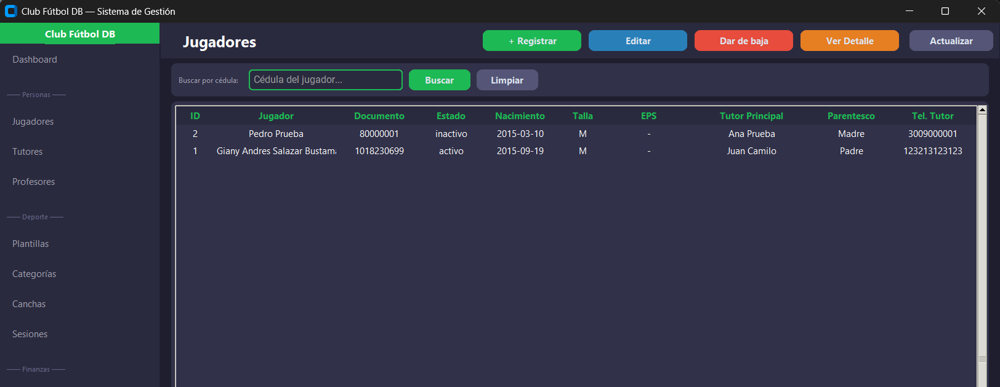 | `dist/ClubFutbol.exe` generado con `ClubFutbol.spec`, conectado a la base con el `config.ini` que está junto al ejecutable |

## 4. Migraciones aplicadas a la base del club

Cada migración termina con una consulta de verificación (`src/sql/migraciones/`).

| # | Captura | Resultado |
|---|---|---|
| 15 | 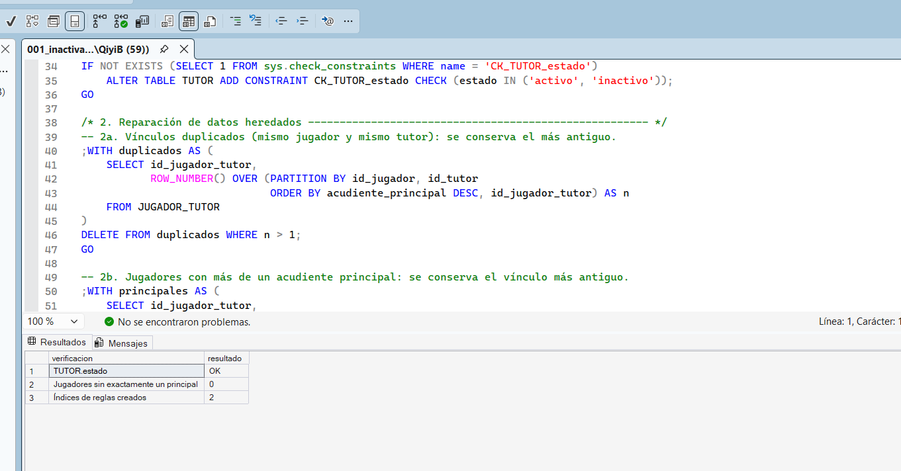 | **001**: `TUTOR.estado = OK`, 0 jugadores sin exactamente un acudiente principal, 2 índices de reglas creados |
| 16 | 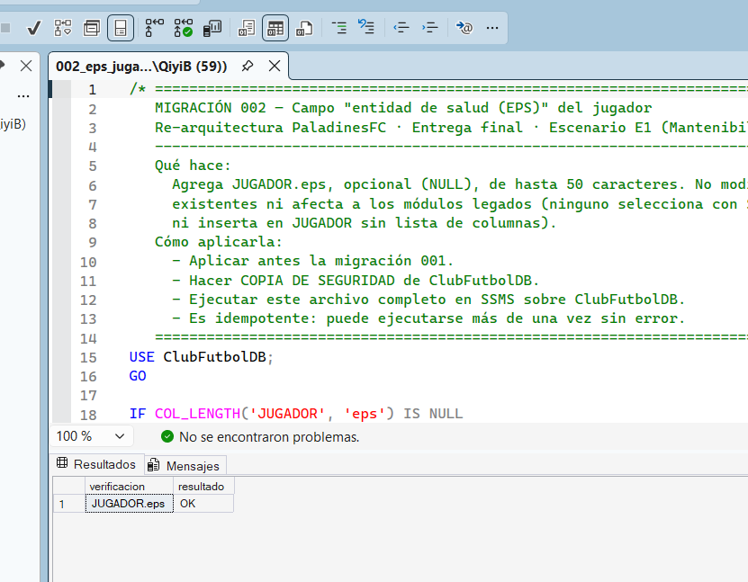 | **002**: `JUGADOR.eps = OK` |
| 17 | 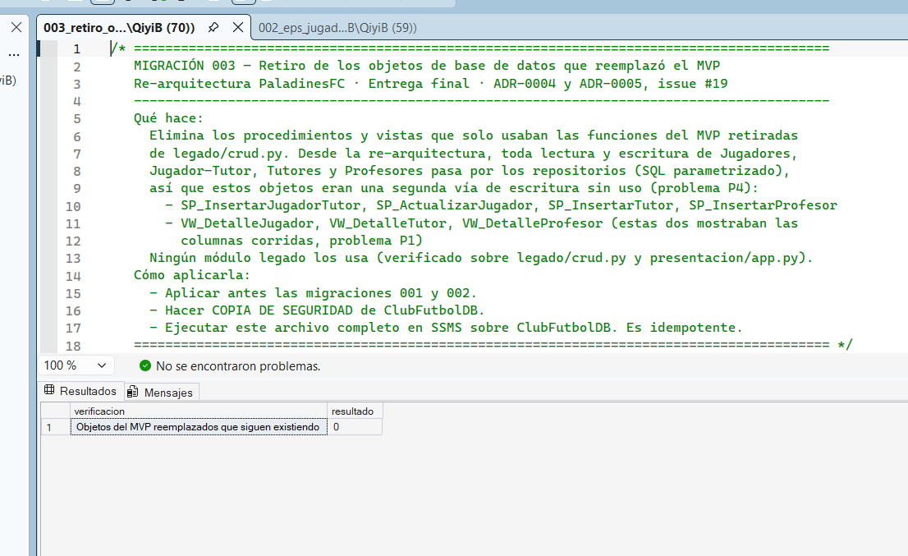 | **003**: 0 objetos reemplazados por el MVP siguen existiendo |
| 18 | 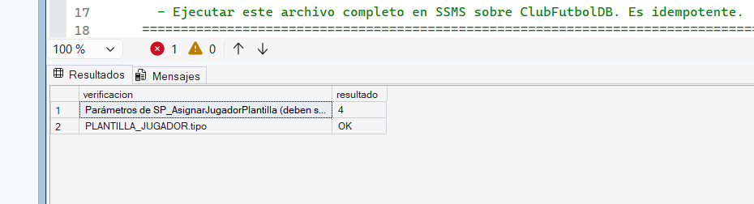 | **004**: `SP_AsignarJugadorPlantilla` con sus 4 parámetros y `PLANTILLA_JUGADOR.tipo = OK` |

## 5. Hallazgo de las pruebas de integración en la base real

| # | Captura | Qué muestra |
|---|---|---|
| 19 | 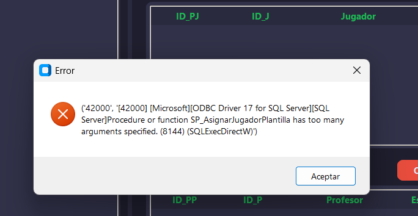 | Antes de la migración 004, "Añadir titular" fallaba con el error 8144 (*too many arguments*): por un `GO` faltante en el script original, la base del club se había quedado con la versión de 3 parámetros de `SP_AsignarJugadorPlantilla`. Las pruebas de integración detectaron el defecto en el script (paso 12) y la migración 004 lo reparó en las bases existentes |

## 6. API REST y pruebas

| # | Captura | Qué muestra |
|---|---|---|
| 20 | 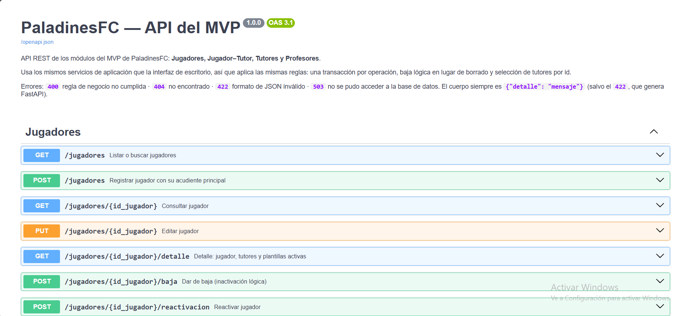 | **Swagger** (`python run_api.py` → <http://127.0.0.1:8000/docs>): los 26 endpoints del MVP |
| 21 | 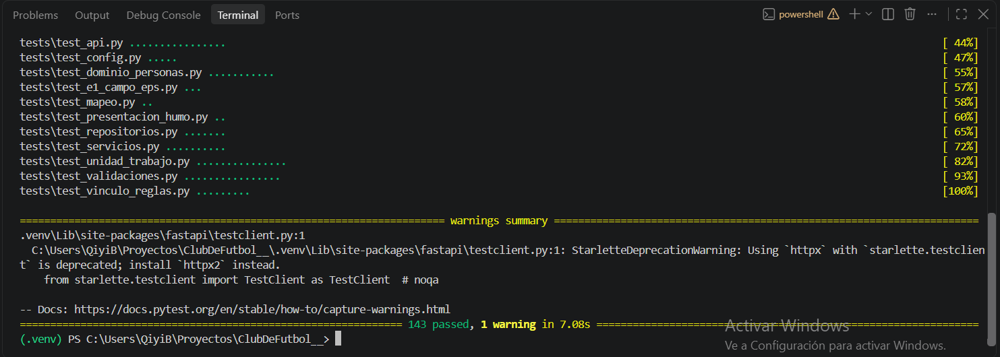 | `python -m pytest --integracion`: todas las pruebas en verde contra SQL Server real |
| 22 | 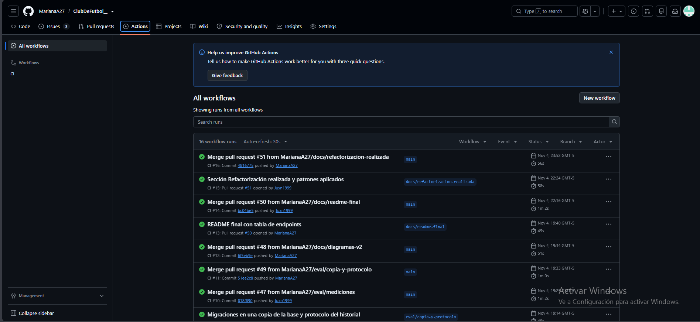 | **GitHub Actions**: pruebas unitarias e integración contra SQL Server 2022 en verde |

## Guion del video corto (1–2 minutos)

1. **Aplicación de escritorio (40 s):** abrir `ClubFutbol.exe` → Jugadores (columna EPS)
   → registrar un jugador con su tutor → Ver detalle → intentar desvincular al acudiente
   principal (la aplicación lo impide con un mensaje claro) → cambiar el principal.
2. **Baja lógica (20 s):** Profesores → dar de baja a un profesor → Sesiones → Nueva
   sesión: ya no aparece en el desplegable → volver a Profesores y reactivarlo.
3. **API REST (30 s):** `python run_api.py` → Swagger → `GET /jugadores` → `POST /tutores`
   con un documento repetido (respuesta `400` con el mismo mensaje que ve la usuaria).
4. **Pruebas (20 s):** `python -m pytest --integracion` y la pestaña Actions en verde.
